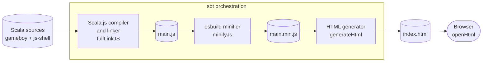

# js-shell

A browser front end for the emulator. It renders the Game Boy screen to a canvas, loads ROMs through a file input, and feeds keyboard input to the joypad.

## How it works

The shell is ordinary Scala.js code in `Shell.scala`. It uses `scalajs-dom` to build the DOM, so it needs a browser runtime. sbt orchestrates a build that turns the Scala sources into one self-contained HTML file.

The build has three components, each consuming one artifact and producing another:

- the Scala.js compiler and linker, run by `fullLinkJS`
- the esbuild minifier, run by `minifyJs`
- the HTML generator, run by `generateHtml`

`openHtml` is the runtime step. It runs after the pipeline and hands the final page to the browser. Cylinders below are artifacts written to disk, rectangles are build components, and the stadium is the external browser.



The task dependencies form a chain. Requesting the last task runs everything before it.

```
run -> openHtml -> generateHtml -> minifyJs -> fullLinkJS
```

## Tasks

- `minifyJs` depends on the link and minifies the linked output with esbuild. It returns the minified file.
- `generateHtml` embeds the minified file into `index.html` and returns it.
- `openHtml` generates the HTML and opens it in the default browser.
- `run` is overridden to call `openHtml`. This replaces the default Scala.js Node run, so `jsShell/run` only works in a browser.

## Running

```
sbt jsShell/run
```

This compiles, links, minifies, writes `index.html`, and opens it in the browser.

The artifacts are written under `target/scala-<version>/s4gb-js-shell-opt/`:

- `main.js` is the unminified linked output.
- `main.js.map` is its source map.
- `main.min.js` is the minified output.
- `index.html` is the self-contained page that inlines `main.min.js`.

The minify step shells out to `npx --yes esbuild@0.28.2`, so it needs Node and `npx` on `PATH` and network access on a cold cache. If the desktop API is unavailable, `openHtml` falls back to `xdg-open`, `open`, or `cmd /c start` depending on the OS.

## Controls

- Arrow keys: D-pad
- `Z`: A
- `X`: B
- Enter: Start
- Backspace: Select
